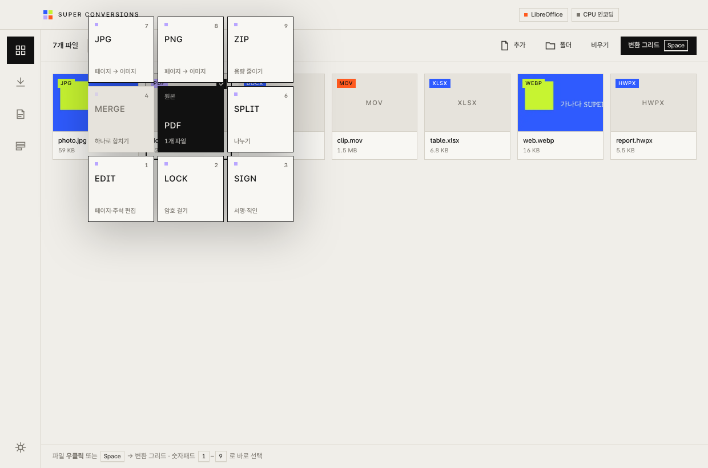
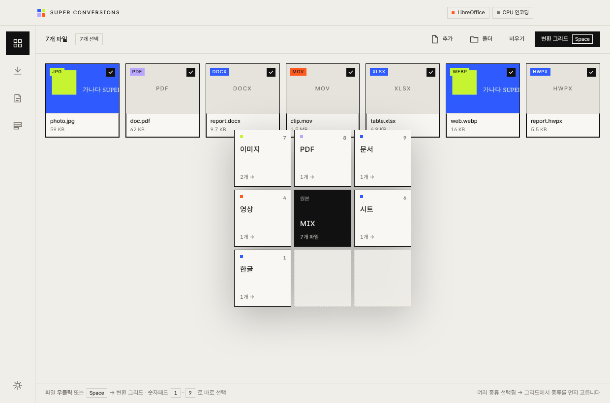
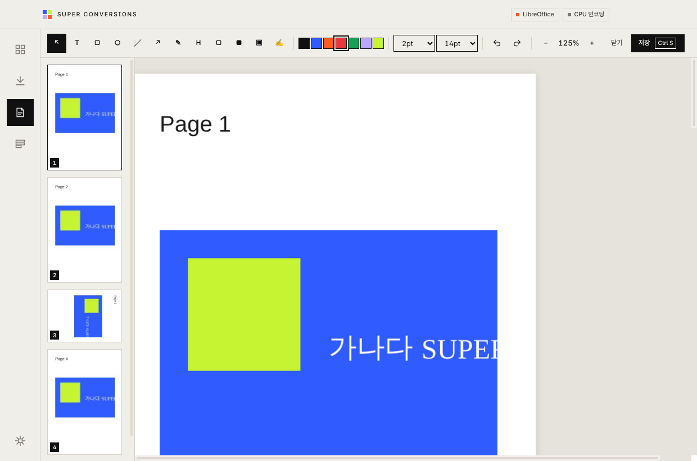
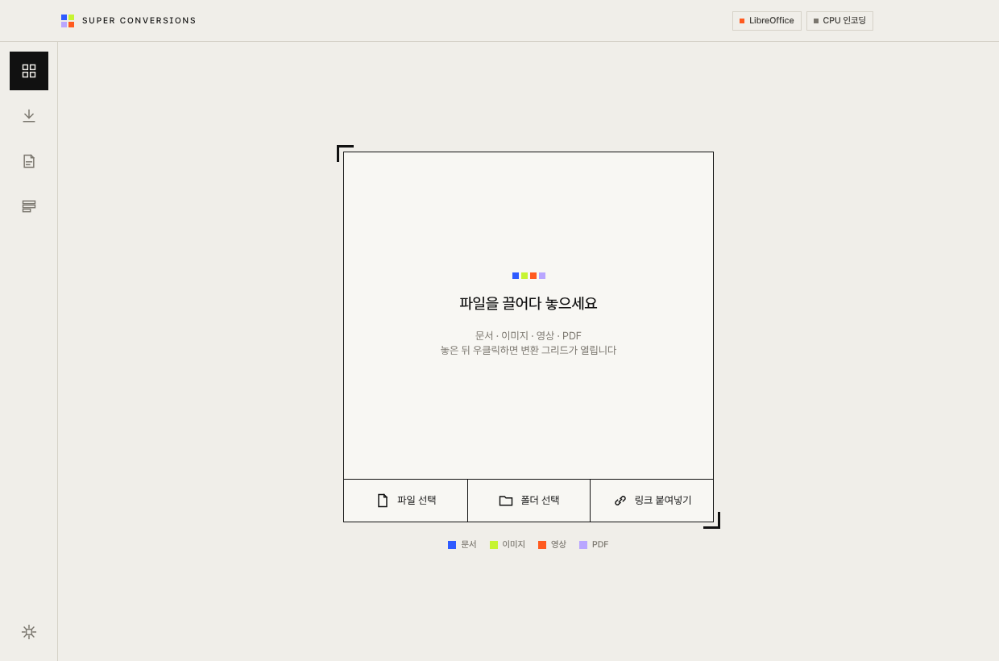
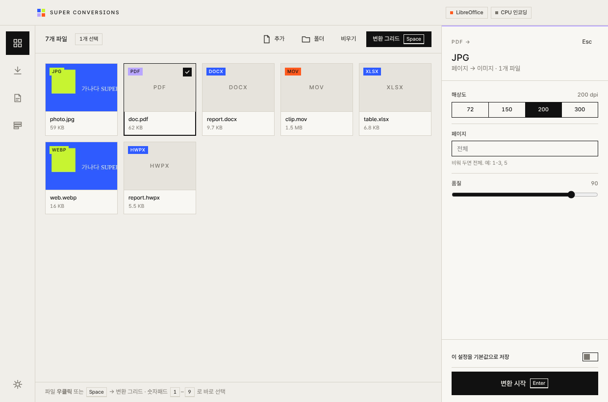
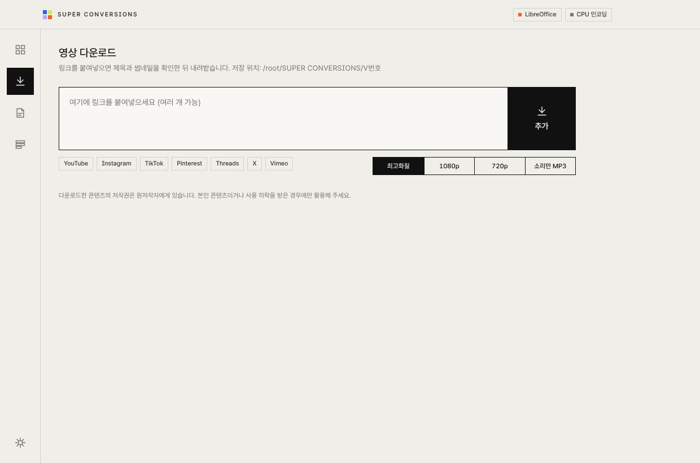
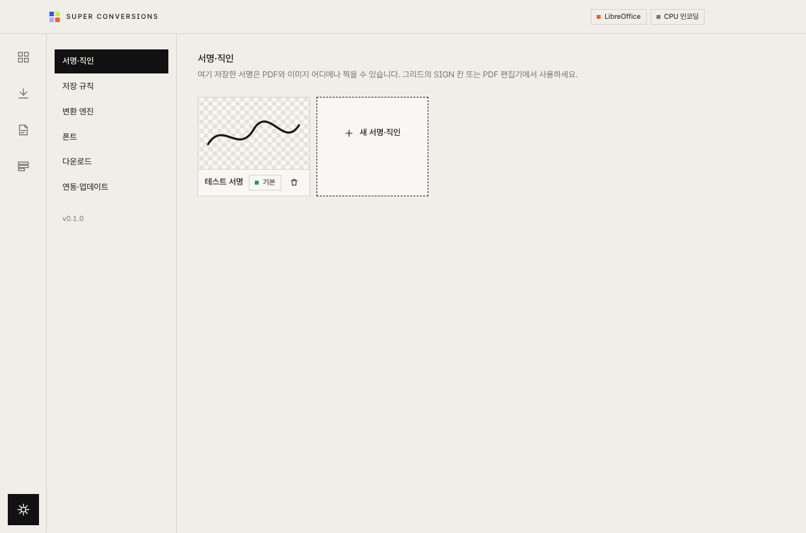

# Super Conversions

**문서 · 이미지 · 영상 · PDF를 한 곳에서 변환하는 로컬 설치형 데스크톱 툴** — THE FROM

파일을 끌어다 놓고 우클릭하면 3×3 정사각 그리드가 펼쳐집니다. 원하는 칸을 고르면 변환이 끝납니다. 모든 작업은 내 컴퓨터 안에서만 처리되고, 파일은 어떤 서버로도 업로드되지 않습니다.



---

## 목차

1. [왜 만들었나](#왜-만들었나)
2. [특징](#특징)
3. [지원하는 변환](#지원하는-변환)
4. [설치](#설치)
5. [사용법](#사용법)
6. [한계와 주의사항](#한계와-주의사항)
7. [업데이트](#업데이트)
8. [개발자 안내](#개발자-안내)
9. [오픈소스 고지](#오픈소스-고지)

---

## 왜 만들었나

변환 서비스는 기능마다 흩어져 있고(PPT→PDF 따로, HEIC→JPG 따로, MOV→MP4 따로), 대부분 파일을 외부 서버에 올려야 합니다. 무엇보다 **폰트와 서식이 깨지는 경우가 많습니다.** 무료 변환기 대부분이 Office를 흉내 내는 호환 엔진으로 문서를 다시 그리기 때문입니다.

Super Conversions는 이 세 가지를 한 번에 해결하려고 만들었습니다.

- **한 앱에서:** 문서·이미지·영상·PDF 변환과 PDF 편집, 영상 다운로드까지 처리합니다.
- **내 PC에서:** 업로드 없이 로컬에서 처리합니다.
- **원본 서식 그대로:** 이 PC에 설치된 Office·한컴오피스를 직접 구동해서 변환합니다.

## 특징

### 1. 서식 보존을 최우선으로 하는 하이브리드 엔진

| 상황 | 쓰는 엔진 | 서식 보존 |
|---|---|---|
| MS Office가 설치된 PC | PowerPoint·Excel·Word를 화면 없이 직접 구동해 내보내기 | ◎ 원본과 사실상 동일 |
| Office가 없고 LibreOffice가 있는 PC | LibreOffice | ○ 일부 차이 가능 |
| 한컴오피스가 설치된 Windows | 한컴오피스를 직접 구동 | ◎ |
| 한컴오피스가 없는 PC | 내장 HWP 변환기 (베타) | △ 텍스트·표 중심 |

- **엔진 자동 선택:** 앱이 실행될 때 설치된 프로그램을 감지해서 가장 좋은 엔진을 고릅니다. 상단의 상태 표시(Office / LibreOffice / 한컴 / GPU 가속)로 확인할 수 있습니다.
- **변환 전 폰트 점검:** 문서가 쓰는 폰트가 이 PC에 있는지 미리 검사합니다.
- **변환 후 검수:** 결과 PDF에 폰트가 모두 들어갔는지, 페이지 수가 맞는지 확인해 **결과 리포트**로 보여줍니다.
- **엑셀 시트 맞춤:** xls→pdf에서 표가 여러 장으로 잘리는 문제를 `열 너비에 맞춤` / `시트당 1페이지` 옵션으로 막습니다.

### 2. 우클릭 3×3 그리드

- **배치:** 가운데 칸은 원본 형식이고, 주변 8칸이 변환할 형식입니다. 칸 색으로 종류를 구분합니다.

  | 색 | 종류 |
  |---|---|
  | 코발트 | 문서 |
  | 라임 | 이미지 |
  | 오렌지 | 영상 |
  | 라벤더 | PDF |

- **숫자패드로 선택:** 칸 위치가 숫자패드 배열과 같습니다. 익숙해지면 키보드 숫자 하나로 변환할 수 있습니다.
- **여러 종류를 함께 고르면:** 그리드가 먼저 "어떤 종류를 변환할지"를 묻고, 그다음 해당 종류의 변환 칸을 보여줍니다.
- **탐색기·Finder에서 바로:** 앱을 열지 않고 탐색기나 Finder에서 우클릭해도 커서 위치에 그리드가 바로 뜹니다.



### 3. 결과는 버전별 폴더로

원본은 절대 덮어쓰지 않습니다. 실행할 때마다 원본 옆에 새 버전 폴더를 만듭니다.

```
프로젝트 폴더/
├─ 제안서.pptx                         ← 원본 (그대로)
└─ SUPER CONVERSIONS/
   ├─ V1/제안서.pdf                     ← 첫 번째 실행
   ├─ V2/제안서.pdf                     ← 옵션을 바꿔 다시 실행
   └─ V3/제안서_01.jpg, 제안서_02.jpg …
```

- **파일명:** 원본 파일명을 유지합니다.
- **이름이 겹칠 때:** `파일명 (2)`처럼 번호가 붙습니다.

### 4. 일괄 처리

- **여러 파일·폴더 한 번에:** 수백 개를 한꺼번에 넣어도 됩니다. 폴더를 넣으면 하위 폴더 안의 지원 파일까지 모두 담깁니다.
- **동시 처리:** 이미지·PDF는 여러 개를 동시에 처리합니다. Office·영상 작업은 안정성을 위해 하나씩 처리합니다.
- **진행 표시:** 각 파일의 타일 테두리가 사각형을 따라 차오르며 진행률을 보여줍니다.

### 5. 앱 전체에서 쓰는 서명·직인

- **한 번 등록, 어디서나 사용:** 설정에 한 번 등록하면 PDF와 이미지 어디에나 찍을 수 있습니다.
- **등록 방법:** 화면에 직접 그리기, 이미지 불러오기(흰 배경 자동 제거), 타이핑(손글씨 서체) 중에서 고릅니다.
- **안전한 보관:** 이 컴퓨터의 보안 저장소(macOS 키체인 / Windows 데이터 보호)에 암호화해 저장합니다.

### 6. PDF 편집기

- **페이지 편집:** 순서 바꾸기(드래그), 회전, 삭제, 빈 페이지 삽입, 다른 PDF 끼워 넣기.
- **주석:** 텍스트, 사각형, 원, 선, 화살표, 펜, 형광펜, 흰색 덮기, 이미지, 서명.
- **가리기(완전 삭제):** 해당 페이지를 이미지로 다시 만들어 가린 아래의 글자를 실제로 지웁니다. 단순히 검은 상자를 덮는 방식이 아닙니다.



---

## 지원하는 변환

| 원본 | 변환할 수 있는 것 |
|---|---|
| **이미지**<br>JPG, PNG, WEBP, GIF, TIFF, BMP, AVIF, HEIC, PSD, SVG | JPG · PNG · WEBP · AVIF · TIFF<br>크기·용량 조정 (긴 변 / 가로 / % / 정확한 크기, **목표 용량 KB 지정**)<br>PDF로 묶기 (한 파일 또는 각각)<br>서명·직인 찍기 |
| **문서**<br>DOC, DOCX, ODT, RTF | PDF · DOCX · HWP/HWPX · 페이지 이미지(JPG) |
| **슬라이드**<br>PPT, PPTX, ODP | PDF · PPTX · 슬라이드 이미지(JPG/PNG) |
| **시트**<br>XLS, XLSX, CSV, ODS | PDF (시트 맞춤) · XLSX · CSV |
| **한글**<br>HWP, HWPX | PDF · DOCX · 페이지 이미지 · HWP↔HWPX |
| **PDF** | JPG · PNG (해상도·페이지 지정)<br>용량 줄이기 · 병합 · 분할 (한 장씩 / N장씩 / 범위)<br>암호 걸기 (AES-256, 인쇄·복사·편집 권한) · 서명 · 편집기 |
| **영상**<br>MOV, MP4, M4V, AVI, MKV, WEBM, WMV, FLV, 3GP, MTS | MP4 · MOV · WEBM · GIF<br>소리만 추출 (MP3/M4A/WAV) · 용량 줄이기 (목표 MB 지정)<br>해상도 변경 · 구간 자르기 |
| **오디오**<br>MP3, WAV, M4A, AAC, FLAC, OGG, OPUS, WMA | MP3 · M4A · WAV · FLAC |
| **링크** | YouTube · Instagram · TikTok · Pinterest · Threads · X · Vimeo 영상 다운로드 |

- **MOV→MP4는 대부분 몇 초 만에 끝납니다.** 원본이 H.264/HEVC면 다시 압축하지 않고 포장만 바꿔서, 화질 손실이 0입니다.
- **영상 재압축은 그래픽카드 가속을 씁니다.** NVIDIA · Intel · AMD · Apple Silicon을 자동으로 감지합니다.

---

## 설치

### 1. 내려받기

[**Releases 페이지**](https://github.com/FROM-i/super-conversions/releases/latest)에서 운영체제에 맞는 파일을 받습니다.

| 운영체제 | 파일 |
|---|---|
| Windows 10 / 11 (64bit) | `SuperConversions-Setup-x.y.z.exe` |
| macOS (Apple Silicon: M1 이후) | `SuperConversions-x.y.z-arm64.dmg` |

### 2. Windows 설치

1. `SuperConversions-Setup-x.y.z.exe`를 실행합니다.
2. **"Windows의 PC 보호" 파란 창이 뜨면** `추가 정보` → `실행`을 누릅니다.
   - 아직 Windows 코드서명 인증서를 적용하지 않아서 뜨는 경고입니다. 파일에는 문제가 없습니다.
3. 설치 폴더를 고르고 설치를 마칩니다. 바탕화면과 시작 메뉴에 바로가기가 생깁니다.

### 3. macOS 설치

1. `.dmg`를 열고 `Super Conversions`를 `응용 프로그램` 폴더로 끌어다 놓습니다.
2. 첫 실행 때 **"확인되지 않은 개발자" 경고가 뜨면** 앱을 **우클릭 → 열기 → 열기**를 누릅니다.
   - Apple 서명을 적용한 빌드부터는 이 경고가 뜨지 않습니다.
3. 처음으로 Office 문서를 변환할 때 **"Super Conversions가 Microsoft PowerPoint를 제어하려고 합니다"** 창이 뜨면 `허용`을 누릅니다.

### 4. 함께 설치하면 좋은 프로그램 (선택)

| 프로그램 | 이유 | 없으면 |
|---|---|---|
| **Microsoft Office** | 원본 서식 그대로 변환하는 1순위 엔진 | LibreOffice로 변환 (서식 일부 차이) |
| **LibreOffice** (무료) | Office가 없는 PC의 대체 엔진 | Office 문서 변환 불가 |
| **한컴오피스** (Windows) | HWP 고품질 변환, HWP(구형) 저장 | 내장 변환기 (베타) |

LibreOffice는 앱의 **설정 › 변환 엔진 › 설치** 버튼으로 바로 받을 수 있습니다. 영상 처리(FFmpeg)와 다운로드 엔진은 앱 안에 포함되어 있거나 자동으로 설치되므로 따로 준비할 것이 없습니다.

### 5. 우클릭 메뉴 연동 (선택)

**설정 › 연동·업데이트**에서 켭니다.

- **Windows:** 파일 탐색기 우클릭 메뉴에 `Super Conversions`가 추가됩니다. Windows 11에서는 `더 많은 옵션 표시` 안에 있습니다.
- **macOS:** Finder 우클릭 › `빠른 동작`(또는 `서비스`)에 추가됩니다. 보이지 않으면 `시스템 설정 › 키보드 › 키보드 단축키 › 서비스`에서 켜 주세요. `다음으로 열기 › Super Conversions`로도 열 수 있습니다.

### 삭제

- **Windows:** `설정 › 앱`에서 Super Conversions를 제거합니다.
- **macOS:** 응용 프로그램 폴더에서 앱을 휴지통으로 옮깁니다.

설정과 서명은 사용자 폴더에 남아 있어서 다시 설치해도 그대로 유지됩니다.

---

## 사용법

### 기본 흐름



1. **파일 넣기:** 창에 파일이나 폴더를 끌어다 놓거나, `파일 선택` / `폴더 선택`을 누릅니다.
2. **선택하기:** 변환할 파일을 클릭합니다. `Ctrl/⌘+클릭`으로 여러 개, `Shift+클릭`으로 범위, `Ctrl/⌘+A`로 전체를 고릅니다. 아무것도 선택하지 않으면 전체가 대상입니다.
3. **그리드 열기:** 파일을 **우클릭**하거나 `Space`를 누릅니다.
4. **칸 고르기:** 마우스로 누르거나 숫자패드 숫자를 누릅니다. 오른쪽에 옵션 패널이 열립니다.
5. **실행:** `Enter` 또는 `변환 시작`을 누릅니다. 옵션 없이 바로 실행하려면 칸을 `Shift+클릭`합니다.
6. **결과 확인:** 원본 옆 `SUPER CONVERSIONS/V번호` 폴더에 저장됩니다. 왼쪽 **작업** 메뉴에서 결과 리포트를 보고 폴더를 열 수 있습니다.



### 그리드 키보드

```
┌───┬───┬───┐
│ 7 │ 8 │ 9 │
├───┼───┼───┤      가운데(5) = 원본 형식
│ 4 │ ■ │ 6 │      숫자 = 해당 칸 선택
├───┼───┼───┤
│ 1 │ 2 │ 3 │
└───┴───┴───┘
```

| 키 | 동작 |
|---|---|
| `1`–`9` (숫자패드 또는 숫자열) | 해당 위치의 칸 선택 |
| `Shift` + 숫자 / 클릭 | 옵션 없이 바로 실행 |
| `←↑↓→` + `Enter` | 방향키로 이동 후 선택 |
| `Esc` | 닫기 (여러 종류를 고른 상태에서는 한 단계 뒤로) |
| `Backspace` | 종류 선택 화면으로 돌아가기 |

### 옵션을 기본값으로 저장

옵션 패널 아래 **"이 설정을 기본값으로 저장"**을 켜고 실행하면, 다음부터 그 변환은 같은 옵션으로 시작합니다. 탐색기·Finder 우클릭 그리드에서 바로 실행할 때도 이 기본값을 씁니다.

### 결과 리포트 읽는 법 (작업 메뉴)

| 표시 | 의미 |
|---|---|
| `Microsoft PowerPoint` / `LibreOffice` / `한컴오피스` / `내장 변환기` | 실제로 쓴 엔진 |
| `서식 보존 ◎ / ○ / △` | 엔진과 폰트 상태로 판단한 예상 품질 |
| `폰트 포함 12/12` | PDF에 들어간 폰트 수 / 전체 폰트 수. 같아야 다른 PC에서도 똑같이 보입니다 |
| `PC에 없는 폰트 N` | 원본이 쓰는데 이 PC에 없는 폰트. 대체 폰트로 바뀌었을 수 있습니다 (마우스를 올리면 목록) |
| `20 → 20쪽` | 슬라이드 수와 PDF 페이지 수 비교 |
| `2.4 MB → 380 KB (−84%)` | 용량 변화 |

### PDF 편집기

보드에서 PDF를 **더블클릭**하거나 그리드의 `EDIT` 칸을 누르면 열립니다. 저장하면 원본은 그대로 두고 `SUPER CONVERSIONS/V번호`에 새 PDF를 만듭니다.

| 키 | 도구 | 키 | 도구 |
|---|---|---|---|
| `V` | 선택·이동 | `P` | 펜 |
| `T` | 텍스트 (더블클릭으로 수정) | `H` | 형광펜 |
| `R` | 사각형 | `W` | 흰색으로 덮기 |
| `O` | 원 | `X` | **가리기 (내용 완전 삭제)** |
| `L` | 선 | `I` | 이미지 |
| `A` | 화살표 | `S` | 서명·직인 |

- **편집:** `Ctrl/⌘+Z` 실행 취소, `Ctrl/⌘+Shift+Z` 다시 실행, `Delete`로 선택한 주석 삭제.
- **보기·저장:** `+` / `-`로 확대·축소, `Ctrl/⌘+S`로 저장.
- **페이지 썸네일:** 마우스를 올리면 회전·빈 페이지 삽입·삭제 버튼이 나타납니다. 끌어서 순서를 바꿀 수 있습니다.

### 서명·직인 등록

1. **설정 › 서명·직인 › 새 서명·직인**을 누릅니다.
2. `직접 그리기` / `이미지 불러오기` / `타이핑` 중에서 고릅니다. 종이에 찍은 도장 사진은 `흰 배경 자동 제거`를 켜면 깔끔하게 정리됩니다.
3. 여러 개를 저장할 수 있고, 그중 하나를 **기본**으로 지정합니다.
4. 사용하는 곳은 두 군데입니다.
   - 그리드의 `SIGN` 칸 (PDF·이미지 일괄 서명: 위치·크기·찍을 페이지 지정)
   - PDF 편집기의 `S` 도구 (원하는 위치에 직접 배치)

### 영상 다운로드



1. 영상 링크를 복사한 뒤 앱 아무 곳에서나 `Ctrl/⌘+V`를 누르면 다운로드 화면으로 이동합니다. 여러 링크를 한 번에 붙여넣어도 됩니다.
2. 제목과 썸네일을 확인하고 화질(`최고화질` / `1080p` / `720p` / `소리만 MP3`)을 고릅니다.
3. `다운로드`를 누르면 `다운로드 폴더/SUPER CONVERSIONS/V번호`에 저장됩니다.
4. Instagram처럼 로그인이 필요한 영상은 **설정 › 다운로드 › 로그인 쿠키를 가져올 브라우저**에서 평소 로그인해 둔 브라우저를 지정합니다.

### 설정 한눈에 보기



| 메뉴 | 내용 |
|---|---|
| 서명·직인 | 등록, 기본 지정, 삭제 |
| 저장 규칙 | 결과 폴더 이름, 동시 처리 개수, 우클릭 그리드 즉시 실행 여부 |
| 변환 엔진 | 감지된 엔진, Office 문서 기본 엔진, LibreOffice 경로·설치 |
| 폰트 | 변환 전 폰트 점검, 한글↔영문 폰트 이름 별칭 (예: `맑은 고딕=Malgun Gothic`) |
| 다운로드 | 저장 위치, 로그인 쿠키 브라우저, 다운로드 엔진 자동 업데이트 |
| 연동·업데이트 | 탐색기·Finder 우클릭 연동, 앱 자동 업데이트, 화면 테마 |

---

## 한계와 주의사항

솔직하게 정리한 현재의 한계입니다. 결과물을 외부로 보내기 전에는 한 번 열어서 확인하는 것을 권합니다.

### 문서 변환

- **Office가 없으면 서식이 달라질 수 있습니다.** LibreOffice는 Office 레이아웃을 흉내 내는 엔진이라 줄 바꿈, 표 너비, 도형 위치가 조금씩 다를 수 있습니다.
- **폰트가 없으면 어떤 엔진도 원본과 같을 수 없습니다.** 원본이 쓴 폰트가 이 PC에 없으면 대체 폰트로 바뀝니다. 결과 리포트의 `PC에 없는 폰트`를 확인하고, 필요하면 폰트를 설치한 뒤 다시 실행해 주세요.
- **라이선스상 PDF에 넣을 수 없는 폰트가 있습니다.** 이런 폰트는 Word에서 `이미지로 고정` 옵션으로 모양을 지키지만, 그 부분의 글자는 복사·검색이 되지 않습니다.
- **Excel for Mac은 시트 맞춤 자동화가 Windows보다 제한적입니다.**
- **PDF → Word/PPT 역변환은 지원하지 않습니다.** 어떤 도구로 해도 손실이 커서 넣지 않았습니다.

### 한글(HWP)

- **한컴오피스가 없을 때의 내장 변환기는 베타입니다.** 텍스트, 글자 서식, 표만 옮겨집니다. 글상자·도형·이미지·머리말·각주는 빠지거나 위치가 달라질 수 있습니다.
- **HWP(구형 바이너리)로 저장하려면 한컴오피스가 설치된 Windows가 필요합니다.** 한컴오피스가 없으면 `HWPX`로 저장하세요. 최신 한글에서 그대로 열립니다.
- **HWP ↔ DOCX는 한컴오피스로 변환해도** 표와 글상자가 일부 어긋날 수 있습니다. 두 형식의 구조가 근본적으로 달라서 생기는 한계입니다.
- **macOS의 한컴오피스는 자동화를 지원하지 않습니다.** Mac에서는 항상 내장 변환기를 씁니다.
- **처음 한글 파일을 변환할 때** 한컴오피스가 "파일 접근 허용" 창을 띄울 수 있습니다. `모두 허용`을 눌러 주세요.

### PDF 편집

- **기존 PDF 글자를 직접 고치는 기능은 없습니다.** 대신 `흰색으로 덮기` + `텍스트`로 덮어 쓰는 방식을 씁니다.
- **가리기(X)를 쓴 페이지는 이미지로 바뀝니다** (200dpi). 그 페이지의 글자는 더 이상 선택·검색되지 않습니다. 정보를 완전히 지우기 위한 의도된 동작입니다.
- **서명은 눈에 보이는 서명 이미지입니다.** 공인인증서 기반의 법적 전자서명이 아닙니다.
- **용량 줄이기는 PDF 안의 사진만 다시 압축합니다.** 글자·벡터 위주의 PDF는 거의 줄지 않을 수 있습니다. 이 경우 원본 크기를 그대로 유지합니다.
- **암호가 걸린 PDF는** 암호를 해제한 뒤에 편집·변환할 수 있습니다.

### 이미지 · 영상

- **PSD는 저장할 때 `호환성 최대화`를 켠 파일이 정확합니다.** 이 옵션이 꺼진 PSD는 레이어를 단순 합성하므로 레이어 효과·조정 레이어·스마트 오브젝트가 빠질 수 있습니다.
- **iPhone HEIC 사진은 내장 디코더로 처리해서** 다른 형식보다 변환이 느립니다.
- **빠른 자르기(무손실)는 키프레임 단위로 잘립니다.** 시작 지점이 1–2초 어긋날 수 있습니다. 정확해야 하면 옵션을 끄세요(다시 인코딩).
- **WEBM(VP9) 변환은 CPU만 써서 느립니다.**

### 영상 다운로드

- **플랫폼이 구조를 바꾸면 일시적으로 실패할 수 있습니다.** 다운로드 엔진(yt-dlp)이 하루 한 번 자동 업데이트해서 보통 며칠 안에 해결됩니다.
- **Threads는 지원이 불안정합니다.** 공개 게시물의 영상만 보조 추출기로 받습니다.
- **비공개·유료·DRM 콘텐츠는 받을 수 없습니다.**
- **다운로드한 콘텐츠의 저작권은 원저작자에게 있습니다.** 본인 콘텐츠이거나 사용 허락을 받은 경우에만 활용해 주세요.

### 설치 · 운영체제

- **Windows:** 코드서명 전이라 설치할 때 SmartScreen 경고가 뜹니다. 우클릭 메뉴가 Windows 11 첫 메뉴가 아니라 `더 많은 옵션 표시` 안에 들어갑니다.
- **macOS:** Apple Silicon(M1 이후) 전용입니다. Intel Mac은 지원하지 않습니다. Apple 서명이 적용되기 전에는 첫 실행 때 우클릭 › 열기가 필요하고, 자동 업데이트가 설치까지 진행되지 않습니다(Releases에서 직접 받기).
- **설치 용량:** 약 150–200MB입니다. 영상 엔진과 문서 렌더러가 포함되어 있습니다.

### 현재 검증 상태 (v0.1)

| 항목 | 상태 |
|---|---|
| 이미지·영상·오디오·PDF 변환, PDF 편집, 서명, V 폴더 | 자동 테스트 통과 (CI에서 매 커밋 실행) |
| LibreOffice 문서 변환, 내장 HWPX 변환 | 자동 테스트 통과 |
| MS Office 직접 구동 (Windows COM / macOS AppleScript) | 실제 PC 검증 진행 중 |
| 한컴오피스 직접 구동, 내장 작성기로 만든 HWPX를 한글에서 열기 | 실제 PC 검증 진행 중 |
| 탐색기·Finder 우클릭 연동, 자동 업데이트 | 실제 PC 검증 진행 중 |

문제가 생기면 [Issues](https://github.com/FROM-i/super-conversions/issues)에 원본 파일 종류, 운영체제, **작업** 메뉴의 오류 메시지를 함께 남겨 주세요.

---

## 업데이트

### 사용자

- **자동으로 받습니다:** 앱이 실행될 때와 4시간마다 새 버전을 확인해 백그라운드로 내려받습니다.
- **적용:** 다 받으면 상단에 **`vX.Y.Z 업데이트 · 재시작`** 버튼이 나타납니다. 누르면 바로 적용되고, 누르지 않아도 다음에 앱을 닫을 때 적용됩니다.
- **직접 확인:** **설정 › 연동·업데이트 › 지금 확인**을 누릅니다.
- **변경 내용:** [CHANGELOG.md](CHANGELOG.md)에서 볼 수 있습니다.

### 관리자 (새 버전 배포)

```bash
npm run release:patch   # 0.1.0 → 0.1.1  버그 수정
npm run release:minor   # 0.1.x → 0.2.0  기능 추가
npm run release:major   # 0.x.y → 1.0.0  큰 변경
```

이 한 줄이 다음을 순서대로 처리합니다.

1. `package.json` 버전을 올립니다.
2. 지난 릴리스 이후의 커밋 제목으로 `CHANGELOG.md`를 채웁니다.
3. 커밋 → `vX.Y.Z` 태그 → GitHub로 올립니다.
4. GitHub Actions가 Windows `.exe`와 macOS `.dmg`·`.zip`을 빌드해 [Releases](https://github.com/FROM-i/super-conversions/releases)에 공개합니다. 약 15–20분 걸립니다.
5. 사용자 PC의 앱이 자동으로 새 버전을 받습니다.

- **커밋 메시지가 곧 변경 기록입니다.** 사용자가 읽을 수 있는 문장으로 써 주세요. 예: `PDF 병합 시 페이지 순서 오류 수정`.
- **태그 번호와 앱 버전이 다르면 배포가 자동으로 중단됩니다.** 수동으로 태그를 만들지 말고 위 명령을 쓰세요.

---

## 개발자 안내

### 요구 사항

- Node.js 22 이상
- 테스트용으로 LibreOffice 설치 권장

### 명령

```bash
npm install            # 의존성 설치
npm run dev            # 개발 모드 실행 (핫 리로드)
npm run typecheck      # 타입 검사
npm run selftest       # 샘플 파일을 만들어 모든 변환을 실행하고 _selftest/selftest-report.json에 기록
npm run dist:win       # 로컬에서 Windows 설치파일 빌드 (Windows에서)
npm run dist:mac       # 로컬에서 macOS 설치파일 빌드 (Mac에서)
```

### 자동화 (GitHub Actions)

| 워크플로 | 언제 | 하는 일 |
|---|---|---|
| `CI` | `main`에 올릴 때, PR | 타입 검사 → 빌드 → 엔진 자가 테스트 (Linux + LibreOffice) |
| `Build & Release` | `v*` 태그를 올릴 때 | Windows·macOS 설치파일 빌드 → Releases 공개 |

### macOS 서명·공증 (권장)

저장소 **Settings › Secrets and variables › Actions**에 아래 값을 넣으면 macOS 빌드가 자동으로 서명·공증됩니다. 서명이 되면 첫 실행 경고가 사라지고 macOS 자동 업데이트도 동작합니다.

| Secret | 내용 |
|---|---|
| `MAC_CERT_P12_BASE64` | Developer ID Application 인증서(.p12)를 base64로 인코딩한 값 (`base64 -i cert.p12 \| pbcopy`) |
| `MAC_CERT_PASSWORD` | .p12 내보내기 암호 |
| `APPLE_ID` | Apple Developer 계정 이메일 |
| `APPLE_APP_SPECIFIC_PASSWORD` | appleid.apple.com › 앱 암호에서 만든 암호 |
| `APPLE_TEAM_ID` | 10자리 팀 ID |

### Windows 코드서명 (예정)

인증서를 구매하면 `WIN_CSC_LINK` / `WIN_CSC_KEY_PASSWORD`를 추가해 SmartScreen 경고를 없애고, 탐색기 첫 우클릭 메뉴(Windows 11) 연동을 진행합니다.

### 구조

```
src/
  shared/        변환 매트릭스 · 타입 · 기본 옵션 (메인/화면 공용)
  main/          Electron 메인 프로세스
    engines/     image · video · office · hwp · docmodel · pdf · fonts · download
    scripts/     office-worker.ps1 — Windows Office·한컴 자동화 워커
    jobs.ts      작업 큐 · 진행률 · 결과 리포트
    output.ts    SUPER CONVERSIONS/V번호 폴더 규칙
    updater.ts   GitHub Releases 자동 업데이트
    integration.ts  탐색기·Finder 우클릭 연동
    selftest.ts  자가 테스트
  preload/       화면에 노출하는 API
  renderer/      React 화면 — 그리드 메뉴, 변환 보드, PDF 편집기, 다운로드, 설정
resources/fonts/ PDF 주석용 Pretendard
docs/            스크린샷
```

---

## 오픈소스 고지

Super Conversions는 다음 오픈소스를 사용합니다. 각 라이선스를 따릅니다.

| 구성 요소 | 용도 | 라이선스 |
|---|---|---|
| [Electron](https://www.electronjs.org/) | 앱 셸 | MIT |
| [FFmpeg](https://ffmpeg.org/) (ffmpeg-static 빌드) | 영상·오디오 처리 | GPL v3 (별도 실행 파일로 포함) |
| [sharp](https://sharp.pixelplumbing.com/) / libvips | 이미지 처리 | Apache-2.0 / LGPL-3.0 |
| [pdf.js](https://mozilla.github.io/pdf.js/) | PDF 렌더링 | Apache-2.0 |
| [@cantoo/pdf-lib](https://github.com/cantoo-scribe/pdf-lib) | PDF 편집·암호화 | MIT |
| [hwp.js](https://github.com/hahnlee/hwp.js) | HWP 해석 | Apache-2.0 |
| [ag-psd](https://github.com/Agamnentzar/ag-psd) | PSD 해석 | MIT |
| [yt-dlp](https://github.com/yt-dlp/yt-dlp) | 영상 다운로드 (첫 사용 시 내려받음) | Unlicense |
| [LibreOffice](https://www.libreoffice.org/) | 대체 문서 엔진 (사용자가 별도 설치) | MPL-2.0 |
| [Pretendard](https://github.com/orioncactus/pretendard) / [나눔손글씨 펜](https://hangeul.naver.com/) | UI · PDF 주석 · 서명 서체 | SIL OFL 1.1 |

HWP 관련 기능은 한글과컴퓨터의 한/글 문서 파일(.hwp) 공개 문서를 참고하여 개발되었습니다.

---

© THE FROM. All rights reserved.
